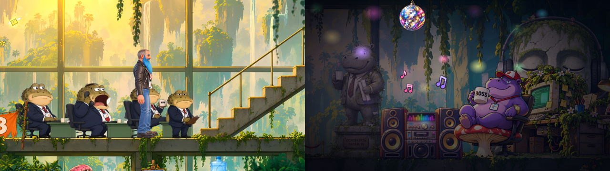

# Nine to Nap

*«Рабочий полдень»* — a looping cartoon workday in a jungle-swallowed open-space office.

**▶ Watch it: https://chegleyev.github.io/nine-to-nap/**

A two-metre bearded biker in a leather jacket and a "NO AI" T-shirt types, fetches coffee, takes calls and listens to
music, until his phone buzzes again. Patam the purple hippo boss wants something. So it's off up the stairs, past the
toad managers and the toad with the clipboard, to answer another very urgent question. Sometimes the reward is a slice
of watermelon. Sometimes it's a dart thrown at the boss's polaroid.

- **The day is different every time.** Each day has four trips to the boss. The breaks (coffee, music, a phone call,
  phone scrolling) and the boss's requests come in random order, with no repeats within a day.
- **The receptionist is a sloth.** He presses one key on his keyboard, very, very slowly.
- **When the day ends, the hero goes home through the «ВЫХОД» arch.** The lights go out and the office empties. Then we
  peek into the boss's office, where the watermelon vase has become a stereo and a disco ball comes down from the
  ceiling.
- **It loops forever.** «На следующий день…» starts another day.

The page has no controls: it just plays. It runs well as an OBS browser source (16:9), for example as a "camera" on
calls.

## How it's made

- **Engine.** Plain TypeScript and raw WebGL, with no game engine.
- **Hero.** The hero is a 2D cut-out (skeletal) rig. He uses rigid parts with round joints, narrow smooth bends at the
  knees and hips, and separate drawings for a bent knee and for sitting.
- **Movement.**
  - Legs and arms are solved by two-bone IK.
  - The floor walk follows curves taken from a motion-capture walk.
  - On the stairs, the feet are placed procedurally, one tread per step.
- **Directing.** A small scene director sequences everything, including the camera moves, the speech bubbles and the
  background animation (blinking eyes, a fly-catching toad, glowing monitors).
- **Artwork.** The artwork was made with AI image generation. It was then cut into parts, registered and assembled by
  hand-written tools.

This repository contains only the built page. It is published with GitHub Pages.
