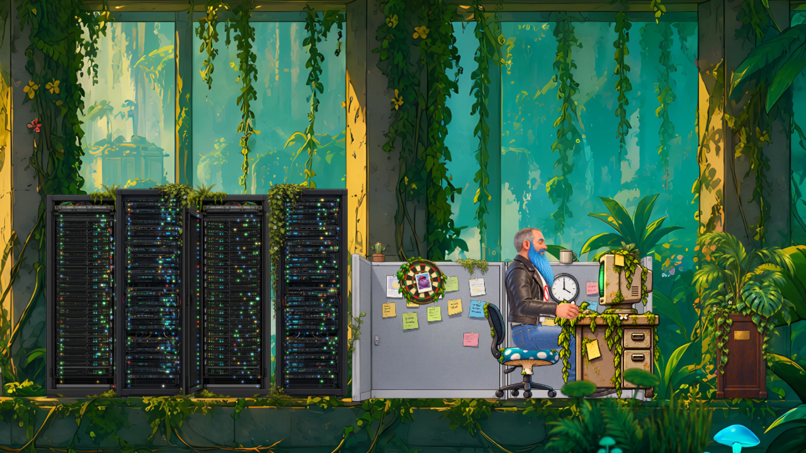

# Nine to Nap

*«Рабочий полдень»* — обычный день программиста в типичном офисе.

**▶ https://chegleyev.github.io/nine-to-nap/**

## Как сделано

- **Движок.** Обычный TypeScript и WebGL, без игровых движков.
- **Герой.** Двумерная перекладка со скелетом: жёсткие детали с круглыми шарнирами, узкие плавные сгибы в коленях и
  бёдрах, отдельные рисунки согнутого колена и посадки.
- **Движение.** Руки и ноги решаются обратной кинематикой на две кости. Ходьба по полу идёт по кривым из записи
  motion capture, на лестнице стопы ставятся процедурно — по ступени на шаг.
- **Режиссура.** Небольшой режиссёр сцены ведёт всё: камеру, реплики в облачках и оживление фона.
- **Рисунки.** Арт сделан генерацией изображений, а затем нарезан на детали, совмещён и собран своими скриптами.
